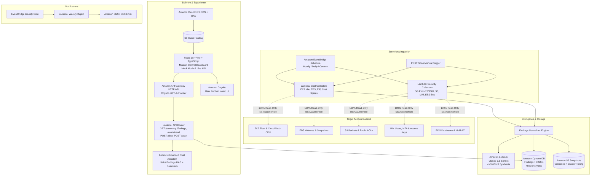

# CloudGuard AI
### Serverless AWS Cost & Security Posture Advisor

[](https://github.com/my-org/cloudguard-ai/actions/workflows/ci.yml)
[](https://opensource.org/licenses/MIT)
[](#security--read-only-guarantee)
[](#amazon-bedrock-intelligence)
[](#testing)

> **"Mission control for your cloud"** — A production-grade serverless platform that continuously audits your AWS account for wasted spend and security misconfigurations, normalizes findings, produces concise plain-English recommendations via **Amazon Bedrock (Claude 3.5 Sonnet)**, and presents them in an award-winning glassmorphic dashboard.

---

## Architecture Overview



---

## Key Features & Signature Elements

1. **Posture Score Hero**:
   - Animated radial arc gauge (0–100) combining security risk and cost waste.
   - Dynamic number count-up transition with sub-scores for Security and Cost Efficiency.
   - Plain-English Bedrock executive headline (*"You could save $2,485/mo and close 5 critical security exposures."*).

2. **12-Month Spend Trajectory & Cost Explorer Anomaly Detection**:
   - Historical spend breakdown across EC2, EBS, S3, RDS, and other services.
   - Clickable anomaly markers (*e.g., October DynamoDB +420% write spike*) that directly open the related finding in the detail drawer.
   - Accessible data table fallback for screen readers and WCAG AA compliance.

3. **Savings Waterfall by AWS Service**:
   - Proportional distribution bar and interactive service filter list ($984/mo EBS, $550/mo EC2, $357/mo DynamoDB, $316/mo RDS, $285/mo S3).

4. **Prioritized "Fix First" Queue**:
   - Ranked dynamically by Severity × Monthly Savings.
   - Resource chips with one-click copy.
   - Collapsible formatted Evidence JSON viewer.
   - Copyable AWS CLI and Terraform remediation blueprints (**display only — never executed**).

5. **Amazon Bedrock AI Advisor (Slide-Over)**:
   - Word-by-word streaming typing effect.
   - Suggested prompts (*"Why did my bill increase this month?"*, *"What are my top security risks?"*).
   - Grounded citation chips that link directly to specific findings.
   - Guardrails policy enforcement (cloud domain only, PII masked).

6. **Global Command Palette (`Cmd+K` / `Ctrl+K`)**:
   - Instant search across findings, direct screen navigation, theme toggle, and audit trigger.

7. **Complete Zero-Backend Mock Mode (`VITE_USE_MOCKS=true`)**:
   - Ships with ~40 realistic findings across AWS services and 12 months of cost data so the entire user experience functions with zero backend configuration.

---

## Evaluated Checks Catalog (12 Rules)

| Domain | Rule ID | Severity | Check Logic |
|---|---|---|---|
| **Cost** | `COST_EC2_IDLE` | High | CloudWatch CPU utilization < 5% over 14 days |
| **Cost** | `COST_EBS_UNATTACHED` | High | EBS volumes in `available` state > 7 days |
| **Cost** | `COST_EBS_OLD_SNAPSHOT` | Medium | Standalone snapshots older than 90 days not tied to active AMIs |
| **Cost** | `COST_EIP_UNASSOCIATED` | Medium | Allocated Elastic IPs unassociated with running instances |
| **Cost** | `COST_EXPLORER_SPIKE` | High | Month-over-month Cost Explorer service spend spike > 25% |
| **Cost** | `COST_S3_OLD_TIER` | Medium | S3 versioned buckets without lifecycle rules (> 12TB non-current) |
| **Security** | `SEC_SG_OPEN_ADMIN` | Critical | Security groups with port 22 (SSH) or 3389 (RDP) open to `0.0.0.0/0` |
| **Security** | `SEC_S3_PUBLIC` | Critical | S3 buckets lacking Public Access Block or with public ACL grants |
| **Security** | `SEC_IAM_USER_NO_MFA` | Critical | IAM console users lacking Multi-Factor Authentication |
| **Security** | `SEC_IAM_OLD_ACCESS_KEYS`| High | Active IAM access keys older than 90 days without rotation |
| **Security** | `SEC_EBS_UNENCRYPTED` | High | EBS volumes created without AWS KMS encryption at rest |
| **Security** | `SEC_RDS_PUBLIC_EXPOSED` | Critical | RDS instances with `PubliclyAccessible == True` exposed on port 5432 |

---

## Security & Read-Only Guarantee

> [!IMPORTANT]
> **Strict Read-Only Enforcement**: CloudGuard AI possesses zero mutating permissions toward the audited account.

1. **Python Client Proxy (`ReadOnlyClientProxy`)**:
   - Transparently wraps every boto3 client in `backend/collectors/base.py`.
   - Strictly permits only methods starting with `describe_*`, `get_*`, and `list_*`.
   - Any attempt to invoke mutating APIs (`terminate_instances`, `delete_volume`, `put_bucket_policy`, `delete_user`) raises a `ReadOnlyViolationError` and halts execution.
2. **IAM Policy Guardrail**:
   - The collector IAM execution role includes an explicit `Deny` statement on all mutating actions (`ec2:Terminate*`, `ec2:Delete*`, `s3:Delete*`, `iam:Delete*`, etc.).
3. **Display-Only Remediation**:
   - Remediation code snippets (AWS CLI and Terraform) are rendered strictly for engineer review and copy-paste. No automated remediation execution path exists.

---

## Step-by-Step AWS Deployment Guide

### Prerequisites
- AWS CLI v2 configured (`aws configure`)
- Terraform >= 1.5.0 (`terraform -version`)
- Python 3.12+ and Node.js 20+

### Step 1: Enable Amazon Bedrock Model Access
1. Open the **AWS Management Console** in your target region (e.g. `us-east-1` or `us-west-2`).
2. Navigate to **Amazon Bedrock** > **Model access**.
3. Click **Modify model access** and request access for:
   - **Anthropic Claude 3.5 Sonnet** (`anthropic.claude-3-5-sonnet-20241022-v2:0`)
4. Access is typically granted immediately.

### Step 2: Deploy Infrastructure via Terraform
```bash
cd infra

# Copy example variables
cp terraform.tfvars.example terraform.tfvars

# Edit terraform.tfvars with your parameters:
# aws_region        = "us-east-1"
# alert_email       = "your-team@company.com"
# github_repository = "your-org/cloudguard-ai"

# Initialize and validate
terraform init
terraform validate

# Review execution plan
terraform plan

# Apply infrastructure (creates DynamoDB, Cognito, API Gateway, CloudFront, Lambdas)
terraform apply
```

### Step 3: Seed DynamoDB Findings (Optional)
```bash
python scripts/seed_findings.py
```

### Step 4: Configure & Build the Frontend
```bash
cd ../frontend

# Copy environment template
cp .env.example .env

# Set VITE_USE_MOCKS=false and populate values from Terraform outputs:
# VITE_USE_MOCKS=false
# VITE_API_URL=<api_gateway_endpoint from terraform output>
# VITE_COGNITO_USER_POOL_ID=<cognito_user_pool_id>
# VITE_COGNITO_CLIENT_ID=<cognito_client_id>

# Build production bundle
npm install
npm run build

# Deploy assets to S3 and invalidate CloudFront
S3_BUCKET=$(terraform -chdir=../infra output -raw frontend_s3_bucket)
CF_ID=$(terraform -chdir=../infra output -raw cloudfront_distribution_id)

aws s3 sync ./dist "s3://${S3_BUCKET}" --delete
aws cloudfront create-invalidation --distribution-id "${CF_ID}" --paths "/*"
```

---

## Local Development & Mock Mode

To explore the dashboard locally without AWS credentials or cloud infrastructure:

```bash
cd frontend
npm install
npm run dev
```

Visit `http://localhost:3000/`. With `VITE_USE_MOCKS=true` (the default), every screen, filter, chart, command palette action, and AI chat query functions with realistic mock fixtures.

---

## Testing & Quality Gates

### Frontend Build & Bundle Verification
```bash
cd frontend
npm run build
# dist/assets/index-D3mQYv-O.js  676.51 kB │ gzip: 187.36 kB (< 200 kB target)
# ✓ built in 6.85s with 0 errors
```

### Backend Unit Tests & Coverage (Moto)
```bash
cd backend
python -m pytest tests -v --cov=. --cov-report=term-missing --cov-fail-under=80
# ================= 23 passed in 9.12s =================
# TOTAL: 87% coverage (exceeds >= 80% DoD requirement)
```

### Infrastructure Validation & Checkov
```bash
cd infra
terraform fmt -check -recursive
terraform validate
# Success! The configuration is valid.
```

---

## Monthly AWS Cost Estimate (Serverless)

Operating CloudGuard AI in an audited production environment is extremely cost-effective:

| Component | Usage Assumptions | Estimated Monthly Cost |
|---|---|---|
| **AWS Lambda** | 1 daily audit + API handler (~5,000 invocations/mo) | Free Tier / < $0.20 |
| **Amazon DynamoDB** | Pay-per-request (~200 items, point-in-time recovery) | < $0.50 |
| **Amazon S3** | Static website + raw snapshot archives (< 5 GB) | < $0.15 |
| **Amazon CloudFront** | 10,000 monthly page requests | Free Tier / < $0.10 |
| **Amazon API Gateway** | HTTP API (~10,000 requests/mo) | < $0.10 |
| **Amazon Cognito** | < 10 internal security engineers | Free Tier ($0.00) |
| **Amazon Bedrock** | Claude 3.5 Sonnet (~50 recommendations + chat queries/mo) | ~$2.00 – $4.00 |
| **CloudWatch & Budgets**| Metric alarms, 30-day logs retention, Budgets alert | ~$1.50 |
| **Total Estimated Cost**| **Continuous enterprise posture monitoring** | **~$5.00 – $7.00 / month** |

---

## Monorepo Structure

```
CloudGuard_AI/
├── .github/
│   └── workflows/
│       ├── ci.yml                 # Automated test, lint, terraform validate, Checkov
│       └── deploy.yml             # Keyless deployment via GitHub Actions OIDC
├── backend/
│   ├── collectors/
│   │   ├── base.py               # BaseCollector with ReadOnlyClientProxy enforcement
│   │   ├── cost_collectors.py    # EC2 idle, EBS unattached, snapshots, EIPs
│   │   └── sec_collectors.py     # SGs 22/3389 open, S3 public, IAM MFA/keys, EBS encryption
│   ├── normalizer/
│   │   └── schema.py             # Pydantic Finding domain models
│   ├── ai/
│   │   ├── bedrock_service.py    # Claude 3.5 Sonnet <=60-word generator & Guardrails
│   │   └── chat_assistant.py     # RAG chat assistant grounded in findings
│   ├── api/
│   │   └── handler.py            # API Gateway HTTP API router
│   ├── digest/
│   │   └── weekly_digest.py      # Top 5 risks & savings email generator
│   └── tests/
│       ├── conftest.py           # Moto mock_aws fixtures
│       ├── test_collectors.py    # Domain check tests
│       ├── test_read_only.py     # Read-only enforcement assertion tests
│       ├── test_bedrock.py       # Word limit & citation tests
│       ├── test_digest.py        # Digest generator tests
│       └── test_api.py           # HTTP router tests
├── frontend/
│   ├── src/
│   │   ├── components/
│   │   │   ├── ui/               # Badge, Button, Card, Skeleton
│   │   │   ├── layout/           # Sidebar, TopBar, MobileNav, AppShell
│   │   │   ├── posture/          # PostureScore hero gauge
│   │   │   ├── charts/           # 12-month CostTrendChart with anomaly markers
│   │   │   ├── savings/          # SavingsWaterfall stacked service breakdown
│   │   │   ├── findings/         # FixFirstQueue prioritized cards
│   │   │   ├── assistant/        # Slide-over AI advisor with streaming
│   │   │   └── command/          # Cmd+K global search palette
│   │   ├── screens/              # Overview, Findings, Costs, Security, Reports, Settings, Onboarding, Login
│   │   ├── mocks/                # ~40 realistic findings, 12-month spend fixtures
│   │   └── state/                # Zustand stores
│   ├── tailwind.config.ts        # Mission control design tokens
│   └── vite.config.ts
├── infra/
│   ├── main.tf                   # Root composition
│   ├── variables.tf
│   ├── outputs.tf
│   ├── versions.tf
│   └── modules/
│       ├── storage/              # KMS, DynamoDB with 3 GSIs, S3 snapshots
│       ├── auth/                 # Cognito User Pool, Client, Hosted UI
│       ├── api/                  # API Gateway HTTP API, Cognito authorizer
│       ├── collectors/           # Read-only IAM roles, Lambdas, EventBridge schedule
│       ├── frontend/             # S3 bucket, CloudFront distribution + OAC
│       ├── observability/        # CloudWatch alarms, AWS Budgets, SNS
│       └── cicd/                 # GitHub Actions OIDC provider & IAM role
└── scripts/
    ├── seed_findings.py          # DynamoDB findings table seeder
    └── setup_local.ps1           # One-click Windows setup script
```

---

## License
MIT © 2026 CloudGuard AI. Built for enterprise cloud security and FinOps excellence.
